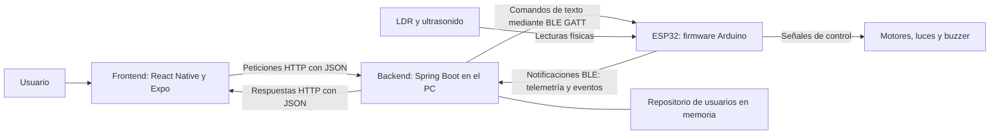
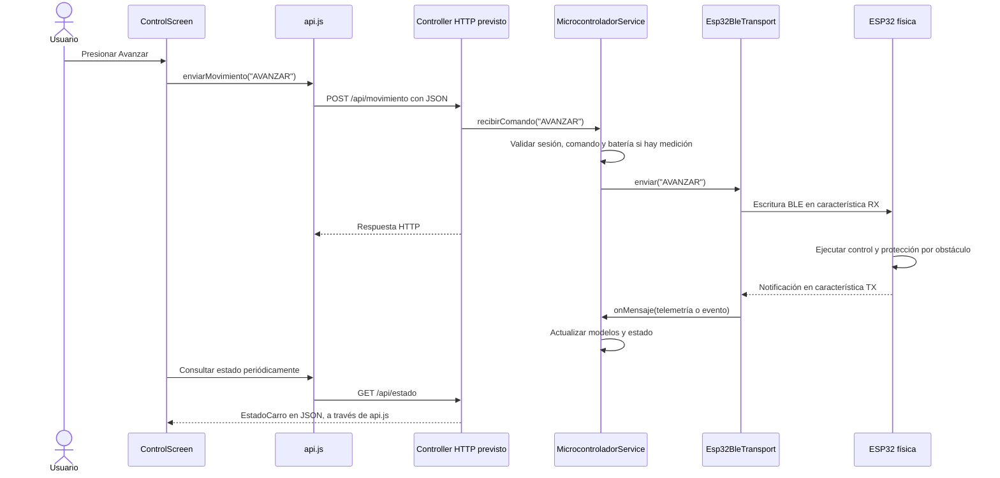
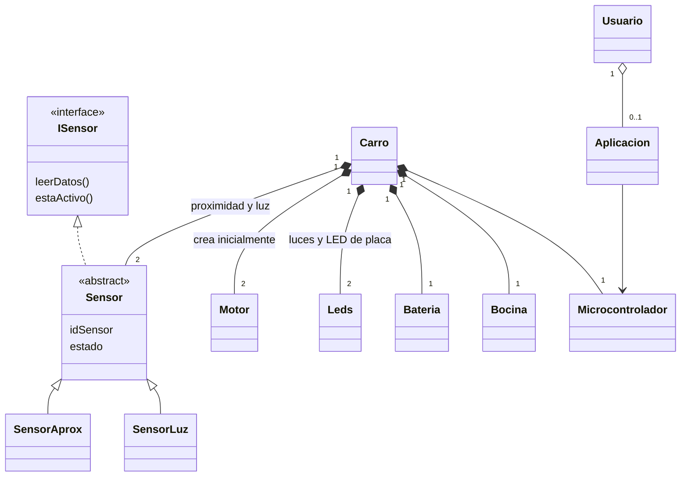
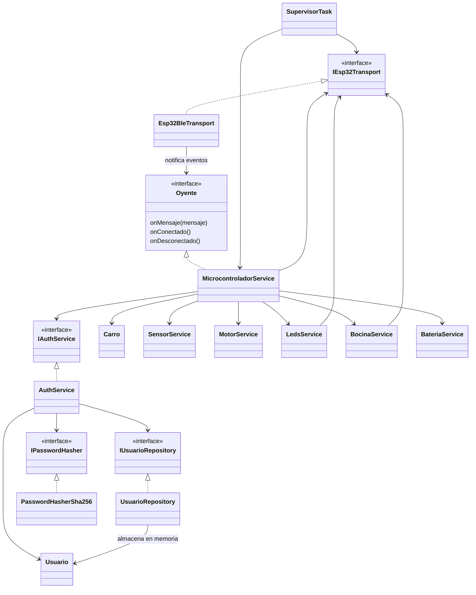

# SmartCar: flujo, tecnologías y guía para los diagramas

Esta guía se basa en los archivos del proyecto revisados el 7 de noviembre de
2026. Distingue la arquitectura prevista de los elementos actualmente conectados
en el código. Es importante actualizarla si cambian los controllers o el firmware.

## 1. Arquitectura general

SmartCar tiene tres aplicaciones: una interfaz web/móvil, un servidor Spring Boot
y un firmware que se ejecuta en la ESP32. El servidor actúa como puente entre la
interfaz y el carro físico.



La API es propia del proyecto. No es un servicio externo ni requiere una clave
de un proveedor. La app principal no se conecta directamente por Bluetooth:
el adaptador Bluetooth utilizado es el del equipo donde corre el backend.
La página HTML de prueba del backend es una excepción: usa Web Bluetooth
directamente contra la ESP32 y no representa el flujo de la app principal.

## 2. Tecnologías identificadas en los archivos

Las versiones siguientes están declaradas en `pom.xml` y `package.json`; no son
una recomendación de versiones ni una afirmación sobre las últimas disponibles.

| Parte | Tecnología | Función |
| --- | --- | --- |
| Backend | Java, objetivo de compilación 17 | Clases del dominio y lógica del servidor |
| Framework | Spring Boot 4.1.1 y starter web | Arranque, servidor HTTP, controllers e inyección de dependencias |
| Construcción Java | Maven y Maven Wrapper | Resolver dependencias, ejecutar pruebas y generar el JAR |
| Bluetooth del PC | SimpleJavaBLE 1.4.0 | Buscar la ESP32, conectarse, escribir comandos y recibir notificaciones |
| Interfaz | JavaScript y React 19.3.0 | Componentes y estado de las pantallas |
| Interfaz móvil | React Native 0.88.1 y Expo ~58.0.23 | Aplicación compartida para Android e iOS |
| Interfaz web | React DOM y React Native Web ~0.21.4 | Ejecutar los componentes en el navegador |
| Almacenamiento de la app | AsyncStorage 2.2.0 | Almacenamiento local utilizado por la interfaz; no sustituye una base de datos del servidor |
| Cliente HTTP | `fetch`, JSON y AbortController | Peticiones, lectura de respuestas y tiempo límite de seis segundos |
| Firmware | C++ con Arduino para ESP32 | Control de GPIO, PWM, sensores y BLE |
| Concurrencia del firmware | Tareas FreeRTOS y colas | Separar comunicación, sensores y control |
| Pruebas | Spring Boot Test, JUnit y Mockito | Comprobar servicios y comportamiento HTTP |

Actualmente `UsuarioRepository` utiliza un `ConcurrentHashMap`. No hay una base
de datos SQL, JPA ni una conexión MySQL que deba dibujarse como parte implementada.
Los usuarios registrados se pierden al reiniciar el backend.

## 3. Estado actual que debe reflejar la documentación

Al revisar esta copia, los archivos `controllers/AuthController.java` y
`controllers/CarroController.java` están vacíos. Por tanto, no se debe presentar
el listado de rutas del frontend como si estuviera implementado actualmente
por esos archivos. Las rutas de la siguiente sección describen el contrato que
espera `frontend/smartcar-app/src/api.js` y que los controllers deben proporcionar.

El repositorio ha tenido un rebase pendiente y problemas con nombres que solo
difieren en mayúsculas. Es recomendable comprobar el estado final de los archivos
antes de entregar un UML que se anuncie como representación exacta de la versión
compilable. Esta guía no modifica ni resuelve ese rebase.

## 4. API entre frontend y backend

`src/api.js` concentra las llamadas HTTP. Las pantallas utilizan sus funciones,
en lugar de repetir direcciones y manejo de errores. Las peticiones incluyen
`Content-Type: application/json`. La URL local habitual del backend usa el puerto
8080; en un celular se utiliza la dirección del PC, no el localhost del teléfono.

| Método | Ruta esperada por el frontend | Operación |
| --- | --- | --- |
| POST | `/api/auth/registro` | Registrar nombre, usuario y contraseña |
| POST | `/api/auth/login` | Verificar credenciales |
| POST | `/api/auth/logout` | Cerrar sesión |
| GET | `/api/auth/sesion` | Consultar la sesión |
| POST | `/api/movimiento` | Enviar un comando, por ejemplo AVANZAR o VEL:200 |
| POST | `/api/movimiento/detener` | Solicitar la detención |
| GET | `/api/estado` | Obtener el estado y las lecturas del carro |
| PUT | `/api/accesorios/luces` | Encender o apagar manualmente las luces |
| POST | `/api/accesorios/luces/auto` | Volver al control automático por luz ambiente |
| PUT | `/api/accesorios/bocina` | Activar o desactivar la bocina manual |

Ejemplo de cuerpo de movimiento:

```json
{"comando": "AVANZAR"}
```

Una respuesta HTTP que acepta el envío no demuestra por sí sola que el carro
se movió. La confirmación física se refleja mediante los eventos y la telemetría
que posteriormente envía la ESP32.

## 5. Flujo de una orden de movimiento

Este diagrama describe el flujo previsto cuando los controllers del contrato
estén implementados. Los servicios y el transporte correspondientes sí existen.



El frontend consulta el estado aproximadamente cada 500 ms. No existe un
WebSocket entre frontend y backend en este diseño. La ESP32 envía notificaciones
BLE por su cuenta; el backend mantiene en memoria la última información recibida.

## 6. Registro, autenticación y errores

El flujo previsto es controller → `IAuthService` → `AuthService`. Al registrar,
`AuthService` valida los datos, usa `IPasswordHasher` para generar sal y hash, crea
un `Usuario` y lo guarda mediante `IUsuarioRepository`. Al iniciar sesión, busca
el usuario y verifica la contraseña. `PasswordHasherSha256` implementa el hash
SHA-256 con sal; no debe describirse como cifrado reversible.

La sesión actual es un usuario guardado en el servicio del backend. No hay JWT,
OAuth ni sesiones independientes por dispositivo implementadas en este servicio.
`UsuarioResponse` permite devolver datos públicos sin exponer el hash y la sal.

`ApiExceptionHandler` traduce errores del dominio a HTTP: sesión ausente a 401,
carro desconectado a 503, batería baja a 409 y argumento inválido a 400.
`ApiError` en el frontend representa errores HTTP y fallos de conexión.

## 7. Para qué sirve cada carpeta del backend

Las carpetas siguientes están dentro de `src/main/java/com/smartcar/backend`.

| Carpeta o clase | Responsabilidad | Ejemplos y contenido relevante para UML |
| --- | --- | --- |
| `controllers` | Recibir HTTP, interpretar la petición, invocar servicios y devolver respuestas | Dibujar como entrada de la API. Actualmente los archivos encontrados están vacíos; marcar los controllers necesarios como pendientes |
| `services` | Coordinar casos de uso, validaciones y actualización de estado | AuthService, MicrocontroladorService, SensorService, MotorService, LedsService, BocinaService, BateriaService, EvasionService y sus interfaces |
| `models` | Representar conceptos y estado del dominio | Carro, Usuario, Motor, Leds, Bocina, Bateria, Microcontrolador, Aplicacion y la jerarquía de sensores. No son entidades JPA por estar en esta carpeta |
| `repository` | Encapsular almacenamiento y búsqueda de usuarios | IUsuarioRepository y UsuarioRepository. El almacenamiento actual es en memoria |
| `dto` | Definir datos que entran y salen de la API | Peticiones y sus records, EstadoCarro, UsuarioResponse. No representan componentes físicos |
| `comunicacion` | Aislar el acceso a BLE y los eventos del enlace | IEsp32Transport, su interfaz Oyente y Esp32BleTransport |
| `config` | Construir e interconectar objetos y configurar infraestructura | AppConfig crea beans y CORS; SupervisorTask programa reconexión y supervisión; ApiExceptionHandler traduce excepciones |
| `excepciones` | Representar fallos específicos del dominio | SesionNoIniciadaException, CarroNoConectadoException y BateriaBajaException |
| `BackendApplication.java` | Punto de entrada de Spring Boot | Inicia el contexto y la aplicación; basta mencionarlo como arranque |

Otras ubicaciones importantes:

| Ubicación | Para qué sirve | Cómo representarla |
| --- | --- | --- |
| `src/main/resources/application.properties` | Nombre de aplicación y parámetros BLE | Configuración del backend, no clase del dominio |
| `src/main/resources/static` | HTML de prueba servido como recurso estático | Interfaz de diagnóstico separada de la app Expo |
| `src/test/java` | Pruebas | Fuera del UML principal de producción |
| `pom.xml`, `.mvn`, `mvnw`, `mvnw.cmd` | Dependencias y construcción | Herramientas en el diagrama de tecnologías |
| `target` | Compilaciones, reportes y JAR generado | Artefacto de despliegue; no clase ni fuente |
| `../esp32/SmartCar/SmartCar.ino`, junto al paquete backend | Firmware actualmente ubicado dentro del árbol Java | Componente ejecutado en la ESP32. Ubicación recomendada: firmware/SmartCar/SmartCar.ino en la raíz del proyecto |

El frontend principal está en `frontend/smartcar-app`: `App.js` decide qué pantalla
mostrar; `src/screens` contiene las pantallas; `src/api.js` realiza HTTP;
`src/theme.js` define presentación. `node_modules`, `.expo` y `dist` son
dependencias, metadatos locales o resultados generados, no capas del dominio.

## 8. Qué incluir en cada diagrama

### Arquitectura y despliegue

Dibujar un dispositivo cliente (navegador o teléfono), un PC con el backend y su
adaptador BLE, una ESP32 con el firmware y los sensores/actuadores. Etiquetar
HTTP/JSON entre cliente y PC, y BLE GATT entre PC y ESP32. Los usuarios en memoria
pertenecen al proceso Java, no a un servidor de base de datos separado.

### UML de dominio

Incluir Carro y sus partes, Usuario, Aplicacion y los sensores. Mostrar atributos
significativos y operaciones principales; no es necesario llenar el diagrama con
todos los getters/setters. Las cardinalidades siguientes describen la creación
inicial en el constructor de Carro; sus listas se exponen mediante getters y el
código no impone que su tamaño nunca cambie.



Las clases Java Microcontrolador y Aplicacion son modelos. No deben confundirse
con el proceso físico de la ESP32 ni con la aplicación Expo: tener una clase con
ese nombre no significa que ejecute firmware o abra una pantalla real.

### UML de diseño de software

Conviene hacerlo separado del dominio para mostrar servicios e interfaces sin
mezclar todo en un único dibujo. Estas relaciones existen en el código revisado:



Oyente corresponde a `IEsp32Transport.Oyente`, no a un archivo independiente.
Agregar en el diseño ampliado las dependencias de LedsService y BocinaService
con IAuthService, y de cada servicio con los modelos que recibe en su constructor.
AppConfig crea las instancias y registra MicrocontroladorService como oyente del
transporte; esto es inyección de dependencias y comunicación por callbacks.

`EvasionService` conserva una lógica local que modifica modelos de motores. Se
construye como bean y se pasa al constructor del servicio central, pero este no
lo almacena ni llama a `evadir()`. La evasión física actual la decide el firmware
al recibir MODO_AUTO. No dibujar una llamada activa desde el servicio central a
EvasionService si se quiere representar el funcionamiento actual.

### Diagrama de paquetes

Usar controllers → services; services → models, repository y comunicacion;
controllers → dto; config → los componentes que construye y supervisa.
La flecha representa una dependencia de código o una invocación, no circulación
de corriente ni cableado. Repository no es una clase padre de Usuario.

### Diagrama de secuencia

Preparar uno para registro/login y otro para movimiento/telemetría. Representar
las rutas como mensajes entre objetos. Una ruta HTTP no es una clase Java y una
interfaz Java no es un endpoint HTTP.

## 9. Particularidades del hardware que afectan al diagrama

El hardware indicado por el usuario no tiene medidor de batería. El firmware
actual usa B:-1 y U:-1 para expresar ausencia de medición; la interfaz muestra
Sin medidor. No dibujar un sensor de batería existente ni un porcentaje medido.
La protección por batería del servicio solo aplica cuando llega un nivel válido.

La interfaz muestra el porcentaje PWM del motor. Eso representa la orden aplicada,
no una medición de velocidad. S:-1 indica que la velocidad no está disponible.
No representar encoders instalados sin confirmar su existencia física.

El LDR en GPIO8 controla las luces en AUTO mediante el voltaje alrededor de
2.5 V. El ultrasonido mide proximidad. La ESP32 decide las salidas de motores,
luces y buzzer, y sus tareas se comunican mediante colas. Los modelos Java
reflejan esas lecturas y estados; por sí solos no actúan sobre un pin físico.

## 10. Lista para preparar la entrega

1. Confirmar que los controllers finales implementen las rutas del cliente HTTP.
2. Resolver los duplicados de nombres por mayúsculas y el rebase antes de tomar
   esa versión como referencia definitiva.
3. Separar arquitectura/despliegue, dominio, diseño de servicios y secuencias.
4. Incluir protocolos y dirección de los mensajes en arquitectura y secuencias.
5. Marcar interfaces, herencia, composición y asociaciones con símbolos distintos.
6. Identificar como pendientes las capacidades que no estén implementadas.
7. Excluir dependencias descargadas, cachés y archivos generados del UML de clases.
8. No dibujar base de datos, JWT, WebSocket, encoders o medidor de batería como
   componentes existentes: no corresponden a esta implementación revisada.
